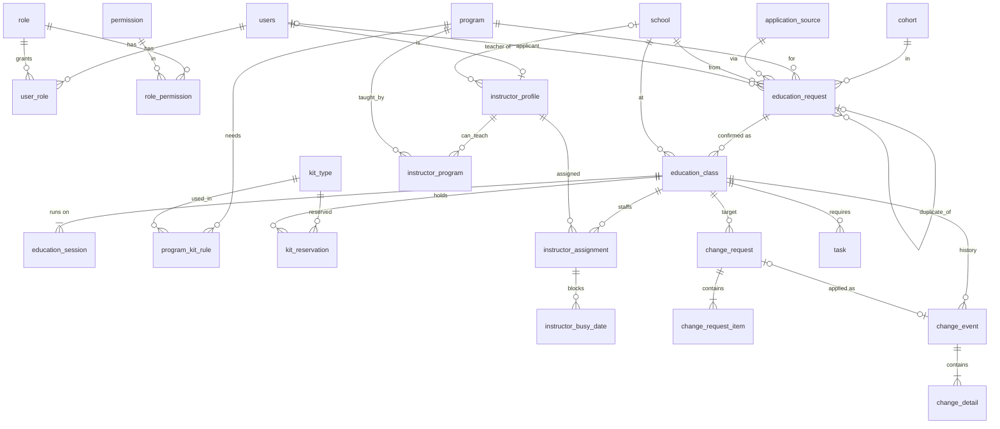

# Massac ERD (MVP1 v0.2)

작성: 2026-11-24 / 기준 문서: `docs/domain.md` / DB: MySQL 8 (MVP2에서 PostgreSQL 전환)
태그: [확정] 업무 사실 또는 결정 / [가설] 설계 제안 / [미정] 결정 필요

범위: MVP1 흐름만 담았다. 운영자 신청 입력 → 교육 확정(차시) → 교구 예약 → 강사 배정 → 변경(운영자 직접 + 신청자 ChangeRequest) → 영향 분석 → Task. 서류, CSV/LMS import, 간식은 제외.

---

## 0. v0.1 → v0.2 변경 요약

| 항목 | v0.1 | v0.2 | 근거 |
| --- | --- | --- | --- |
| 차시 | 하루 한 세션, `UNIQUE(class_id, session_date)` | 하루 여러 차시(1차시 = 1교시), 날짜 + 시작 시간. 학교급별 하루 최대 차시는 설정값 | 답변 4, Q3, Q4 |
| 학교급 | 없음 | `school.level` + `school_level_setting` | 답변 4 |
| 주소 | school에 주소 컬럼 | `Address` 값 객체. 학교 주소는 하나, 교육별로 배송·교육 장소 상세주소 스냅샷 | Q6 |
| cohort | source와 request 양쪽 | request에만 | Q7 |
| 교사 강사 | type만 | type + 소속 학교. 모든 교사가 다른 학교에도 배정 가능 | Q8, Q9 |
| 역할 조합 | 규칙 없음 | 역할별 확정 1명 + "LEAD가 교사면 나머지도 교사" | 피드백, Q12 |
| 교사 추가 업무 | 없음 | 교사 배정 수락 시 Task 2개 생성 | 피드백, Q10, Q11 |
| Task 종료 | status만 | 처리 결과(DONE / NOT_NEEDED) + 사유 + 처리자 기록 | Q11 |
| 관리자 등급 | 미정 | 없음. 관리자는 모든 기능 접근 | 답변 6 |
| 신청 등록 | 미정 | 운영자 직접 입력만. CSV/LMS는 MVP2 | Q1 |
| 신청자 기능 | 미정 | 신청자 로그인 + ChangeRequest MVP1 포함 | Q2 |
| 교구 재예약 | `UNIQUE(class_id, kit_type_id)` | 활성 예약만 1건 (아래 2.4) | 제 결정 |
| 변경 이력의 차시 값 | 미정 | JSON 문자열 (아래 2.6) | 제 결정 |

## 1. 전체 그림

`school_level_setting`은 다른 테이블과 FK 없이 학교급 값으로 조회하는 설정 테이블이라 그림에서 뺐다.

## 2. 테이블

### 2.1 사용자·권한

| 테이블 | 주요 컬럼 | 비고 |
| --- | --- | --- |
| users | id, name, phone, email, status | 현재 `User`(id만)에 컬럼 추가. 로그인은 기존 `basic_auth` |
| role | id, code, name, status | 기존. OPERATOR, KIT_MANAGER, DOC_MANAGER, INSTRUCTOR_MANAGER, ADMIN, APPLICANT, INSTRUCTOR |
| permission | id, code | 예: `class:update`, `kit:reserve`, `change-request:review` |
| user_role | user_id, role_id | 기존. 한 사용자 여러 역할 [확정] |
| role_permission | role_id, permission_id | 신규 |

관리자 등급 없음 [확정]. ADMIN 역할에 모든 permission을 부여한다.

### 2.2 기준 정보

| 테이블 | 주요 컬럼 | 비고 |
| --- | --- | --- |
| cohort | id, name, start_date, end_date | 기간 단위, 관리자가 추가 [확정] |
| program | id, name, kit_shipping_lead_days, kit_return_days, status | 교구 점유 기간 계산용 |
| school | id, name, level, region, address(zip_code, road_address, detail_address) | level: ELEMENTARY, MIDDLE, HIGH. 주소는 `Address` 값 객체(`@Embeddable`) |
| school_level_setting | level(PK), max_periods_per_day | 관리자가 설정 [확정: 설정값] |
| application_source | id, name, type, status | type: PRE_APPLICATION, LMS, PHONE, OPERATOR, INSTRUCTOR_CONTACT. cohort 없음 |

### 2.3 신청과 교육

**education_request** (최초 요청, 값 보존)

| 컬럼 | 설명 |
| --- | --- |
| id, cohort_id, program_id, source_id, school_id | cohort는 여기에만 [확정] |
| external_id | 외부 ID. `UNIQUE(source_id, external_id)`. MVP1은 직접 입력이라 대부분 NULL, MVP2 import 대비 |
| school_name_snapshot, contact_name, contact_phone | 신청 당시 연락처 스냅샷. user와 통합하지 않음 |
| applicant_user_id | 신청자 계정. 운영자가 입력할 때 연결 (없으면 NULL) |
| desired_start_date, student_count, teacher_led | 최초 희망 값. `teacher_led`는 신청 시점의 의도 |
| status | RECEIVED, REVIEWING, NEGOTIATING, CONFIRMED, REJECTED, DUPLICATE, WITHDRAWN |
| duplicate_of_id | 운영자가 중복 판단 시 원 신청 |

**education_class** (확정 교육, 항상 한 학교 [확정])

| 컬럼 | 설명 |
| --- | --- |
| id, request_id, cohort_id, program_id, school_id | |
| student_count | 교육 전체에 하나 [확정] |
| status | CONFIRMED, PREPARING, IN_PROGRESS, COMPLETED, CANCELLED |
| delivery_address (zip, road, detail) | 교구 배송지 스냅샷. 학교 주소를 복사하고 상세주소만 교육별로 수정 (예: 1층 교무실) |
| delivery_recipient_name, delivery_recipient_phone | |
| venue_detail | 교육 장소 상세 (예: 4층 누리반) |
| version | `@Version` 낙관적 락 |

배송지와 교육 장소가 서로 다를 수 있다고 보고 두 칸으로 나눴다 [가설]. 학교 주소 자체는 그대로이고 상세주소만 달라진다는 답을 반영했다.

**education_session** (차시, 1차시 = 1교시 [확정])

| 컬럼 | 설명 |
| --- | --- |
| id, class_id | |
| session_date, start_time | [확정: 날짜 + 시작 시간] |

- `UNIQUE(class_id, session_date, start_time)`
- 한 교육의 같은 날짜 차시 수 ≤ `school_level_setting.max_periods_per_day` (서비스에서 검사)

### 2.4 교구

| 테이블 | 주요 컬럼 | 비고 |
| --- | --- | --- |
| kit_type | id, name, total_quantity | 예약 시 이 행을 `SELECT ... FOR UPDATE`로 잠금 |
| program_kit_rule | id, program_id, kit_type_id, calc_type, value | calc_type: PER_STUDENT(value명당 1개), FIXED(value개) |
| kit_reservation | id, class_id, kit_type_id, quantity, occupy_start, occupy_end, status, active_key | status: RESERVED, SHIPPED, RETURNED, RELEASED |

- occupy_start = 첫 차시 날짜 − 배송 리드타임, occupy_end = 마지막 차시 날짜 + 회수 일수
- 가용량 인덱스: `(kit_type_id, status, occupy_start, occupy_end)`
- **[제 결정] 재예약 허용**: 일정 변경으로 예약을 해제(RELEASED)하고 다시 잡는 일이 생기므로 `UNIQUE(class_id, kit_type_id)`는 뺐다. 대신 `active_key`(RESERVED·SHIPPED면 class_id, 아니면 NULL) 생성 컬럼 + `UNIQUE(active_key, kit_type_id)`로 "활성 예약은 1건"만 보장한다. MySQL 유니크 인덱스는 NULL을 중복으로 보지 않는다.
- 교구 모듈은 school을 참조하지 않는다. 배송지는 education_class의 스냅샷을 받아 쓴다 (교구 서비스 분리 대비).

### 2.5 강사

| 테이블 | 주요 컬럼 | 비고 |
| --- | --- | --- |
| instructor_profile | id, user_id, type, school_id, region | type: EXTERNAL, SCHOOL_TEACHER. school_id는 교사의 소속 학교(외부 강사는 NULL). 이력 불필요 [확정]. `UNIQUE(user_id)` |
| instructor_program | instructor_id, program_id | 교육 가능 프로그램 |
| instructor_assignment | id, class_id, instructor_id, role, instructor_type, status, accepted_key, requested_by, requested_at, responded_at, reject_reason | 아래 참고 |
| instructor_busy_date | instructor_id, busy_date, assignment_id | `UNIQUE(instructor_id, busy_date)` |

**instructor_assignment**
- role: LEAD, ASSISTANT, SAFETY / status: REQUESTED, ACCEPTED, REJECTED, CANCELLED
- 요청마다 새 행을 만든다 → 거절·재요청 이력 자동 보존
- `instructor_type`: 배정 당시 강사 유형 스냅샷. 교사 관련 Task 생성 기준
- 역할별 확정 1명 [확정]: `accepted_key`(ACCEPTED면 class_id, 아니면 NULL) + `UNIQUE(accepted_key, role)`

**강사 규칙**
| 규칙 | 지키는 곳 |
| --- | --- |
| 같은 강사는 같은 날짜에 한 교육만 [확정] | 수락 시 그 교육의 차시 날짜(중복 제거)마다 `instructor_busy_date` insert. 같은 날 여러 교시는 날짜 1행 |
| 역할별 확정 1명, SAFETY는 선택 [확정] | `UNIQUE(accepted_key, role)` |
| LEAD가 교사면 다른 역할도 모두 교사 (2명·3명 모두) [확정] | 수락 시 `StaffingCompositionPolicy` 검사. 동시에 두 배정이 수락되는 경우를 막기 위해 수락 처리 중 education_class 행을 `SELECT ... FOR UPDATE`로 잠근다 |
| 교사는 어느 학교에든 배정 가능 [확정] | 학교 제한 검사 없음 |

허용 조합 (LEAD, ASSISTANT, SAFETY): (교사, 교사, 교사) (강사, 교사, 교사) (강사, 교사, 강사) (강사, 강사, 교사) (강사, 강사, 강사), 그리고 SAFETY 없는 2인 조합.

### 2.6 변경 관리

| 테이블 | 주요 컬럼 | 비고 |
| --- | --- | --- |
| change_request | id, class_id, requester_id, base_version, status, reason, reviewer_id, reviewed_at, review_comment | status: PENDING, APPROVED, REJECTED, AUTO_CLOSED. 신청자가 MVP1에서 직접 생성 [확정] |
| change_request_item | id, change_request_id, field, current_value, requested_value | field: STUDENT_COUNT, SESSIONS, TEACHER_LED, CANCEL |
| change_event | id, class_id, actor_id, channel, reason, change_request_id, created_at | channel: PHONE, KAKAO, SYSTEM, ETC |
| change_detail | id, change_event_id, field, before_value, after_value | |

- 승인 시 `base_version != class.version`이면 운영자에게 경고
- **[제 결정] 차시 값 형식**: 차시는 여러 개라서 before/after를 JSON 문자열로 저장한다. 예: `[{"date":"2026-10-17","start":"09:00"},{"date":"2026-10-17","start":"10:00"}]`. 이력은 조회·표시만 하고 검색 조건으로 쓰지 않으므로 별도 테이블보다 단순한 쪽을 골랐다. MySQL `JSON` 타입 사용.
- 배송지·교육 장소 변경도 change_event로 남긴다

### 2.7 Task

| 컬럼 | 설명 |
| --- | --- |
| id, class_id, task_type | 아래 목록 |
| assignee_role_id, assignee_user_id | |
| due_date, status | status: OPEN, CLOSED, CANCELLED, SUPERSEDED |
| resolution, resolution_note, resolved_by, resolved_at | resolution: DONE, NOT_NEEDED. "불필요" 판단도 사유와 함께 기록 [확정] |
| origin_type, origin_id | CHANGE_EVENT / INSTRUCTOR_ASSIGNMENT / CHANGE_REQUEST |
| description | 예: "학생 수 20 → 25, 간식 수량 변경 필요" |
| open_key | OPEN이면 class_id, 아니면 NULL. `UNIQUE(open_key, task_type)` |

MVP1 task_type
| 타입 | 생성 시점 |
| --- | --- |
| UPDATE_SNACK | 학생 수·일정 변경 |
| CONFIRM_INSTRUCTOR_SCHEDULE | 일정 변경 (배정된 강사별 확인) |
| NEGOTIATE_DATE | 교구·강사 부족으로 일정 조정 필요 |
| NOTIFY_APPLICANT | 확정 정보 변경 |
| ASSIGN_INSTRUCTOR | 교육 확정 시, 배정 수락되면 자동 종료 |
| REVIEW_CHANGE_REQUEST | 신청자가 ChangeRequest 생성 |
| RECEIVE_PRINCIPAL_APPROVAL | 교사 배정 수락 시 (본인 학교·다른 학교 모두) [확정] |
| SEND_OFFICIAL_LETTER | 교사 배정 수락 시. 담당자가 NOT_NEEDED로 종료 가능 [확정] |

`CONFIRM_INSTRUCTOR_SCHEDULE`처럼 대상이 여러 명인 Task는 open_key 유니크와 충돌하므로 강사마다 따로 만들려면 open_key에 대상 id를 포함해야 한다. v0.2에서는 "교육 단위 1건, description에 대상 강사 목록"으로 단순하게 둔다 [가설].

교사 관련 서류 요구사항(DocumentRequirement)은 MVP2에서 서류 모듈과 함께 만들고, MVP1에서는 위 Task로 누락을 막는다.

## 3. 핵심 제약 요약

| 불변식 | 지키는 곳 |
| --- | --- |
| 5. 교구 예약 총량 ≤ 보유량 | kit_type 행 비관적 락 + 서비스 검증 |
| 교구 활성 예약 1건 | `UNIQUE(active_key, kit_type_id)` |
| 6. 강사 같은 날짜 중복 금지 | `UNIQUE(instructor_id, busy_date)` + 서비스 검증 |
| 역할별 확정 1명 | `UNIQUE(accepted_key, role)` |
| LEAD 교사면 전원 교사 | 수락 시 class 행 잠금 + StaffingCompositionPolicy |
| 하루 최대 차시 | 서비스 검증 (school_level_setting) |
| 2. 승인 전 변경 금지 | change_request 별도 저장, 승인 시에만 class 수정 |
| 4. 변경 이력 | change_event + change_detail |
| 10. 후속 업무 유실 방지 | 변경, change_event, task 저장을 한 트랜잭션에서 |
| 같은 종류 열린 Task 1건 | `UNIQUE(open_key, task_type)` |
| 동시 수정 | education_class.version |

## 4. 남은 [미정]
- 신청 우선순위의 Tier 내 정렬 키 순서 (ERD 영향 없음, 조회 로직)
- 중복 신청 판별 기준 (MVP2)
- 교구 파손·분실 처리
- 서류 보관·삭제 정책 (MVP2)
